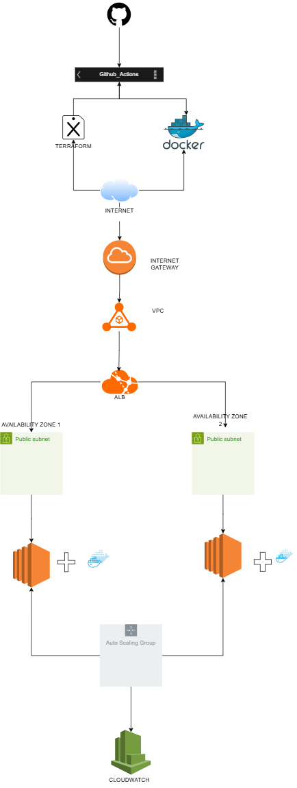

# AWS Cloud Infrastructure Automation with Terraform

A hands-on AWS infrastructure project that provisions a Dockerized web application behind an Application Load Balancer (ALB), with an EC2 Auto Scaling Group and a GitHub Actions workflow for image publishing and Terraform validation/planning.

> **Implementation note:** This repository is an infrastructure assessment/lab. The workflow currently builds and pushes the Docker image and runs `terraform init`, `terraform validate`, and `terraform plan`. It does **not** run `terraform apply` or perform an automated production deployment.

## Architecture



The Terraform configuration currently defines:

- A custom VPC with DNS support and hostnames enabled.
- Two public subnets across the first two available Availability Zones.
- Two private subnets (created, but not currently used by the Auto Scaling Group).
- An Internet Gateway and public route table.
- An internet-facing Application Load Balancer in the public subnets.
- An EC2 Launch Template and Auto Scaling Group.
- A target group with an HTTP health check on `/`.
- Security groups allowing HTTP from the ALB to EC2.

**Current network placement:** The Auto Scaling Group is configured to launch EC2 instances in the two public subnets. The private subnets are provisioned but are not yet connected to a private route table/NAT design or used by the application instances.

## Technology stack

| Technology | Purpose |
|---|---|
| AWS VPC, subnets, Internet Gateway | Network foundation |
| EC2 Launch Template | Instance configuration |
| Auto Scaling Group | Maintain and scale EC2 capacity |
| Application Load Balancer | Distribute HTTP traffic |
| Security Groups | Restrict inbound network access |
| Terraform | Infrastructure as Code |
| Docker | Package the static web application |
| Docker Hub | Store the application image |
| GitHub Actions | Build/push image and validate/plan infrastructure |
| CloudWatch / AWS metrics | Platform metrics available for operational monitoring |

## Repository layout

```text
.
├── .github/workflows/deploy.yml
├── app/
│   ├── Dockerfile
│   └── index.html
├── terraform/
│   ├── main.tf
│   ├── provider.tf
│   ├── variables.tf
│   ├── outputs.tf
│   ├── userdata.sh
│   └── .terraform.lock.hcl
├── architecture-diagram.png
└── README.MD
```

## Prerequisites

- AWS account and permissions to create the resources defined in `terraform/main.tf`.
- AWS CLI configured locally, or credentials available through the GitHub Actions secrets.
- Terraform 1.x.
- Docker.
- An EC2 key pair in the selected AWS region if you intend to use SSH.
- A Docker Hub account/repository accessible to the workflow.

The default AWS region is `ap-south-1` (Mumbai). The EC2 key pair name is supplied through the required `key_name` Terraform variable.

## Run the application container locally

From the repository root:

```bash
docker build -t cloud-app:local ./app
docker run --rm -p 8080:80 cloud-app:local
```

Open `http://localhost:8080`.

## Validate and plan the infrastructure

From the repository root:

```bash
cd terraform
terraform init
terraform fmt -check
terraform validate
terraform plan \
  -var="key_name=YOUR_EC2_KEY_PAIR_NAME" \
  -var="ssh_allowed_cidr=YOUR_PUBLIC_IP/32"
```

Review the plan carefully before applying any infrastructure changes. To provision resources manually after review:

```bash
terraform apply \
  -var="key_name=YOUR_EC2_KEY_PAIR_NAME" \
  -var="ssh_allowed_cidr=YOUR_PUBLIC_IP/32"
```

The ALB DNS name is exposed as the `load_balancer_dns` output:

```bash
terraform output load_balancer_dns
```

To remove lab resources when they are no longer needed:

```bash
terraform destroy \
  -var="key_name=YOUR_EC2_KEY_PAIR_NAME" \
  -var="ssh_allowed_cidr=YOUR_PUBLIC_IP/32"
```

Check the plan before confirming destroy. AWS resources can incur charges while running.

## GitHub Actions configuration

The workflow in `.github/workflows/deploy.yml` runs on pushes to `main`. Configure these repository Actions secrets:

| Secret | Purpose |
|---|---|
| `AWS_ACCESS_KEY_ID` | IAM access key used by the workflow |
| `AWS_SECRET_ACCESS_KEY` | IAM secret access key |
| `DOCKER_USERNAME` | Docker Hub username |
| `DOCKER_PASSWORD` | Docker Hub access token/password |

The current workflow:
1. Checks out the repository.
2. Configures AWS credentials in `ap-south-1`.
3. Logs in to Docker Hub.
4. Builds and pushes `nandheeswaran/cloud-app:v1`.
5. Runs Terraform init, validate and plan.

**It stops at Terraform Plan.** Review and apply infrastructure changes manually. For a stronger production workflow, prefer GitHub OIDC with an IAM role over long-lived AWS access keys, add pull-request validation, and require approval before any apply stage.

## Security and design considerations

- SSH ingress is restricted by the `ssh_allowed_cidr` variable. Set it to your own public IP in CIDR form (for example, `203.0.113.10/32`); do not open SSH to `0.0.0.0/0`.
- The ALB currently listens on HTTP port 80. HTTPS with ACM is a future enhancement.
- EC2 instances currently launch in public subnets. A production design should move application instances into private subnets and provide controlled outbound access (for example, NAT or suitable VPC endpoints).
- The private subnets are declared but are not yet used by the Auto Scaling Group.
- Terraform state files, variable files, private keys and credentials must never be committed.
- Use least-privilege IAM permissions and rotate credentials if they are ever exposed.

## Roadmap

- [ ] Move EC2 instances into private subnets and implement the required egress design.
- [ ] Add HTTPS using ACM and an HTTPS ALB listener.
- [ ] Replace long-lived AWS keys in Actions with GitHub OIDC.
- [ ] Add PR checks for formatting, validation and plan review.
- [ ] Add explicit CloudWatch alarms and an operational dashboard.
- [ ] Add deployment/rollback strategy and tested health checks.
- [ ] Parameterize image repository and tag rather than hard-coding them.

## Author

**Nandheeswaran M** — DevOps / Cloud Engineering

- [GitHub](https://github.com/Nandhi005)
- [LinkedIn](https://www.linkedin.com/in/nandheeswaran-m-09a8a6244/)
- [Portfolio](https://nandhi005.github.io/Nandhe_Portfolio/)
